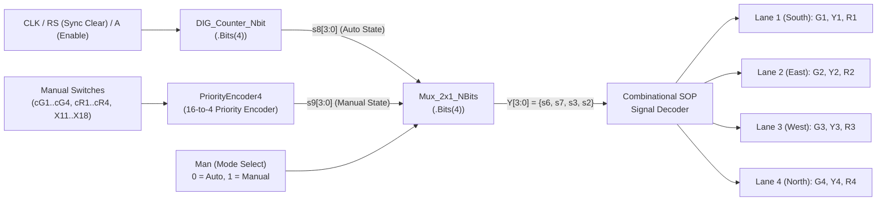

# 4-Way Intersection Traffic Light Controller (Verilog HDL)

A modular **4-way road traffic light controller** designed and verified in **Verilog HDL**, supporting both **Automatic timed FSM sequencing** and **Manual priority-encoded signal override**. Built around a parameterized 4-bit synchronous counter, a 16-to-4 priority encoder, a 4-bit 2:1 mode multiplexer, and a minimized Sum-of-Products (SOP) combinational lamp decoder driving 12 directional signal outputs (`Green`, `Yellow`, `Red` across South, East, West, and North approaches).

## Key Features

- **Dual Operating Modes (`Man` Select)**:
  - **Automatic Mode (`Man = 0`, `A = 1`)**: Cycles continuously through a 16-count (`0000`–`1111`) 8-phase traffic schedule with a **3:1 Green-to-Yellow duration ratio** (3 clock ticks per directional Green phase, 1 clock tick per two-way Yellow transition phase).
  - **Manual Override Mode (`Man = 1`)**: Bypasses the automatic counter via a 4-bit 2:1 multiplexer and maps manual Green/Red control switches (`cG1`–`cG4`, `cR1`–`cR4`) directly to valid intersection states through a 16-input priority encoder.
- **Parameterized RTL Building Blocks**: Reusable `DIG_Counter_Nbit`, `Mux_2x1_NBits`, and `PriorityEncoder4` Verilog modules instantiated inside the `FinalTraffic` top-level entity.
- **Glitch-Minimized SOP Output Decoding**: Direct combinational decoding from the active 4-bit state vector `Y[3:0]` to all 12 lamp outputs (`G1/Y1/R1` through `G4/Y4/R4`).
- **Waveform-Verified Testbench**: Validated across both sequential automatic cycling and asynchronous manual preemption.

## RTL Datapath Architecture



## 8-State Finite State Machine (FSM)

The 4-bit counter progresses from `0000` (`0`) to `1111` (`15`) and wraps around cleanly, allocating **1 tick** to dual-approach Yellow prepare/clear transitions and **3 ticks** to single-approach protected Green movements:

```mermaid
stateDiagram-v2
    direction LR
    state "1. NSYOR (0000)\nNorth & South Yellow\nOthers Red" as NSYOR
    state "2. SGOR (0001-0011)\nSouth Green\nOthers Red" as SGOR
    state "3. SEYOR (0100)\nSouth & East Yellow\nOthers Red" as SEYOR
    state "4. EGOR (0101-0111)\nEast Green\nOthers Red" as EGOR
    state "5. EWYOR (1000)\nEast & West Yellow\nOthers Red" as EWYOR
    state "6. WGOR (1001-1011)\nWest Green\nOthers Red" as WGOR
    state "7. WNYOR (1100)\nWest & North Yellow\nOthers Red" as WNYOR
    state "8. NGOR (1101-1111)\nNorth Green\nOthers Red" as NGOR

    [*] --> NSYOR : RS = 1 (T = 0000)
    NSYOR --> SGOR : NEXT
    SGOR --> SEYOR : NEXT (after 3 ticks)
    SEYOR --> EGOR : NEXT
    EGOR --> EWYOR : NEXT (after 3 ticks)
    EWYOR --> WGOR : NEXT
    WGOR --> WNYOR : NEXT (after 3 ticks)
    WNYOR --> NGOR : NEXT
    NGOR --> NSYOR : NEXT (wrap 1111 -> 0000)
```



## Module Hierarchy & Port Specification

| Module | Parameters | Role |
| :--- | :--- | :--- |
| **`FinalTraffic`** | — | Top-level 4-way controller integrating counter, priority encoder, mode mux, and SOP decoder |
| **`DIG_Counter_Nbit`** | `Bits = 4` (default `2`) | Synchronous rising-edge binary counter (`C`, synchronous clear `clr`, enable `en`, overflow `ovf`) |
| **`PriorityEncoder4`** | — | 16-input (`in0`–`in15`, `in15` highest priority) to 4-bit (`num[3:0]`) combinational encoder with `any` flag |
| **`Mux_2x1_NBits`** | `Bits = 4` (default `2`) | Parameterized 2:1 bus multiplexer selecting `in_0` (`Auto`) when `sel = 0` or `in_1` (`Manual`) when `sel = 1` |
| **`Final_testbench`** | `CLK_PERIOD = 10` (ns) | Self-contained Verilog simulation testbench exercising Reset, Automatic sequencing, and Manual override |

### Top-Level I/O (`FinalTraffic`)

| Signal(s) | Direction | Width | Description |
| :--- | :--- | :---: | :--- |
| `CLK` | `input` | 1 | System clock driving the 4-bit automatic state counter on `posedge CLK` |
| `RS` | `input` | 1 | Synchronous active-HIGH reset forcing counter state to `4'b0000` (`NSYOR`) |
| `A` | `input` | 1 | Automatic counter enable (`1` = advance state each clock, `0` = hold count) |
| `Man` | `input` | 1 | Mode select (`0` = Automatic counter `s8`, `1` = Manual priority override `s9`) |
| `cG1`, `cG2`, `cG3`, `cG4` | `input` | 4 × 1 | Manual Green override switches for Lanes 1–4 (South, East, West, North) |
| `cR1`, `cR2`, `cR3`, `cR4` | `input` | 4 × 1 | Manual Red override switches for Lanes 1–4 |
| `X11`–`X18` | `input` | 8 × 1 | Auxiliary priority-encoder state inputs mapped to intermediate transition codes |
| `Y` | `output` | 4 | Active 4-bit controller state bus (`{A, B, C, D}` = `{Y[3], Y[2], Y[1], Y[0]}`) |
| `G1, Y1, R1` | `output` | 3 × 1 | **Lane 1 (South)** Green, Yellow, and Red signal outputs |
| `G2, Y2, R2` | `output` | 3 × 1 | **Lane 2 (East)** Green, Yellow, and Red signal outputs |
| `G3, Y3, R3` | `output` | 3 × 1 | **Lane 3 (West)** Green, Yellow, and Red signal outputs |
| `G4, Y4, R4` | `output` | 3 × 1 | **Lane 4 (North)** Green, Yellow, and Red signal outputs |

## State & Override Lookup Tables

### Automatic Mode Truth Table (`Man = 0`)

| State `Y[3:0]` (`ABCD`) | FSM Phase | South (`G1 Y1 R1`) | East (`G2 Y2 R2`) | West (`G3 Y3 R3`) | North (`G4 Y4 R4`) |
| :---: | :--- | :---: | :---: | :---: | :---: |
| `0000` | **1. `NSYOR`** (N–S Yellow) | `0 1 0` | `0 0 1` | `0 0 1` | `0 1 0` |
| `0001` | **2. `SGOR`** (South Green) | `1 0 0` | `0 0 1` | `0 0 1` | `0 0 1` |
| `0010` | **2. `SGOR`** (South Green) | `1 0 0` | `0 0 1` | `0 0 1` | `0 0 1` |
| `0011` | **2. `SGOR`** (South Green) | `1 0 0` | `0 0 1` | `0 0 1` | `0 0 1` |
| `0100` | **3. `SEYOR`** (S–E Yellow) | `0 1 0` | `0 1 0` | `0 0 1` | `0 0 1` |
| `0101` | **4. `EGOR`** (East Green) | `0 0 1` | `1 0 0` | `0 0 1` | `0 0 1` |
| `0110` | **4. `EGOR`** (East Green) | `0 0 1` | `1 0 0` | `0 0 1` | `0 0 1` |
| `0111` | **4. `EGOR`** (East Green) | `0 0 1` | `1 0 0` | `0 0 1` | `0 0 1` |
| `1000` | **5. `EWYOR`** (E–W Yellow) | `0 0 1` | `0 1 0` | `0 1 0` | `0 0 1` |
| `1001` | **6. `WGOR`** (West Green) | `0 0 1` | `0 0 1` | `1 0 0` | `0 1 1` |
| `1010` | **6. `WGOR`** (West Green) | `0 0 1` | `0 0 1` | `1 0 0` | `0 0 1` |
| `1011` | **6. `WGOR`** (West Green) | `0 0 1` | `0 0 1` | `1 0 0` | `0 0 1` |
| `1100` | **7. `WNYOR`** (W–N Yellow) | `0 0 1` | `0 0 1` | `0 1 0` | `0 1 0` |
| `1101` | **8. `NGOR`** (North Green) | `0 0 1` | `0 0 1` | `0 0 1` | `1 0 0` |
| `1110` | **8. `NGOR`** (North Green) | `0 0 1` | `0 0 1` | `0 0 1` | `1 0 0` |
| `1111` | **8. `NGOR`** (North Green) | `0 0 1` | `0 0 1` | `0 0 1` | `1 0 0` |

### Manual Priority-Encoder State Lookup (`Man = 1`)

Higher-indexed encoder inputs (`in15` down to `in0`) take precedence if multiple manual switches are asserted simultaneously:

| Control Switch | Encoder Input | Encoded State `s9[3:0]` | Resulting Intersection Action |
| :---: | :---: | :---: | :--- |
| `cG4` | `in15` (Highest) | `1111` | Forces **North Green** (`NGOR`) |
| `cR4` | `in11` | `1011` | Forces **North Red** (West Green `WGOR`) |
| `cG3` | `in10` | `1010` | Forces **West Green** (`WGOR`) |
| `cR3` | `in7` | `0111` | Forces **West Red** (East Green `EGOR`) |
| `cG2` | `in6` | `0110` | Forces **East Green** (`EGOR`) |
| `cR1` | `in5` | `0101` | Forces **South Red** (East Green `EGOR`) |
| `cG1` | `in1` | `0001` | Forces **South Green** (`SGOR`) |
| `cR2` | `in0` (Lowest) | `0000` | Forces **East Red** (N–S Yellow `NSYOR`) |

## Synthesized Combinational Equations

With state bits mapped as `s6 = Y[3]`, `s7 = Y[2]`, `s3 = Y[1]`, `s2 = Y[0]` and complements `s0 = ~s6`, `s1 = ~s7`, `s4 = ~s3`, `s5 = ~s2`:

```verilog
// Lane 1 (South)
assign G1 = (s0 & s1 & s2) | (s0 & s1 & s3);
assign Y1 = (s0 & s4 & s5);
assign R1 = s6 | (s7 & s2) | (s7 & s3);

// Lane 2 (East)
assign G2 = (s0 & s7 & s2) | (s0 & s7 & s3);
assign Y2 = (s0 & s7 & s4 & s5) | (s6 & s1 & s4 & s5);
assign R2 = (s0 & s1) | (s6 & s7) | (s1 & s2) | (s1 & s3);

// Lane 3 (West)
assign G3 = (s6 & s1 & s2) | (s6 & s1 & s3);
assign Y3 = (s6 & s4 & s5);
assign R3 = s0 | (s7 & s2) | (s7 & s3);

// Lane 4 (North)
assign G4 = (s6 & s7 & s2) | (s6 & s7 & s3);
assign Y4 = (s0 & s1 & s4 & s5) | (s6 & s1 & s4 & s2) | (s6 & s7 & s4 & s5);
assign R4 = (s0 & s7) | (s6 & s1) | (s1 & s2) | (s1 & s3);
```

## Simulation & Verification

1. **Compile & Run with Icarus Verilog (`iverilog`)**:
   ```bash
   iverilog -o traffic_sim FinalTraffic.v Final_testbench.v
   vvp traffic_sim
   ```
   *(Note: Ensure the UUT module instantiation name in `Final_testbench.v` matches `FinalTraffic` if running standalone outside Digital.)*
2. **Verified Test Scenarios**:
   - **Automatic Mode (`A = 1'b1`, `Man = 1'b0`)**: Verified full sequential state progression (`0001 -> 0010 -> ... -> 1111`) across 0–1400 ps waveform capture with mutually exclusive Green phases.
   - **Manual Override Mode (`A = 1'b0`, `Man = 1'b1`)**: Verified immediate multiplexer switchover and priority-encoded jumps (`0001` via `cG1` -> `0110` via `cG2` -> `1010` via `cG3`) without counter interference.

## Future Improvements

- **Adaptive Traffic-Density Scheduling**: Integrate per-lane IR vehicle-density sensors to dynamically weight Green-phase durations and prioritize high-congestion approaches.
- **Synchronized Pedestrian Crosswalk Signals**: Add countdown pedestrian `Walk` / `Don't Walk` outputs interlocked with each approach's Red phase.

## Academic Context

Developed in the **Department of Electronics and Communication Engineering**, Faculty of Engineering and Technology, **Ramaiah University of Applied Sciences (RUAS)**, Bengaluru.
